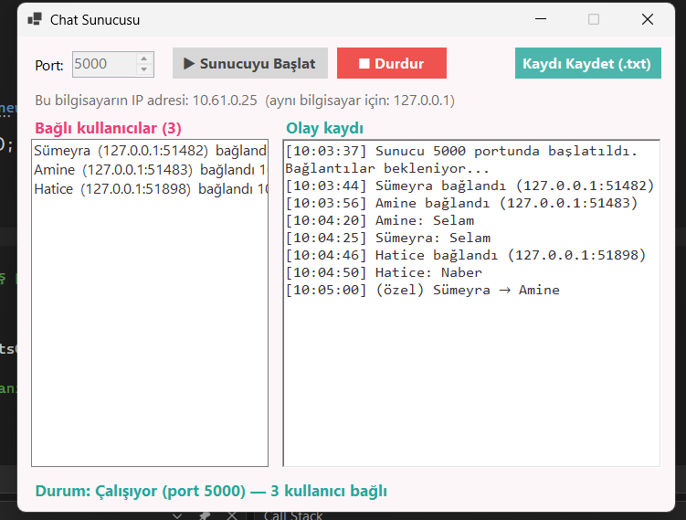
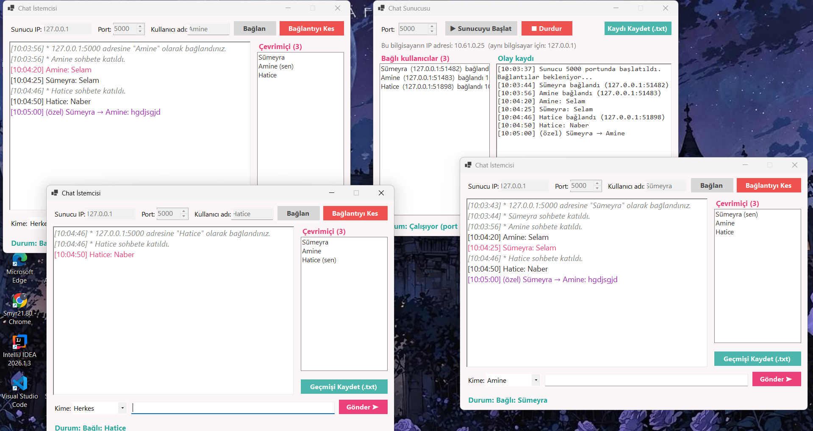

# YMH219 - Chat App

Nesne Tabanlı Programlama (YMH219) dersi kapsamında geliştirilmiş, **TCP/IP** üzerinden çalışan bir istemci-sunucu sohbet uygulamasıdır. Bir sunucu ve birden fazla istemci, aynı bilgisayarda veya aynı yerel ağda birbirleriyle mesajlaşabilir.

## Kullanılan Teknolojiler

- C# / .NET 10
- Windows Forms
- `TcpListener` / `TcpClient` / `NetworkStream` (TCP/IP iletişimi)
- `StreamReader` / `StreamWriter` ile satır tabanlı iletişim
- `System.Text.Json` (mesajların JSON biçiminde gönderilmesi)
- `async` / `await` (arayüzü dondurmadan ağ işlemleri)
- Ek NuGet paketi kullanılmamıştır

## Proje Yapısı

Çözüm üç projeden oluşur:

| Proje | Türü | Görevi |
|---|---|---|
| `ChatShared` | Sınıf kütüphanesi | Sunucu ve istemcinin ortak kullandığı mesaj modeli, bağlantı sınıfı ve renk paleti |
| `ChatServer` | Windows Forms | Bağlantıları kabul eden, mesajları dağıtan sunucu |
| `ChatClient` | Windows Forms | Kullanıcının sohbet ettiği istemci |

| Sınıf | Sorumluluğu |
|---|---|
| `ChatMessage` | Ağda gönderilen tek bir mesaj (tür, gönderen, alıcı, metin, zaman); JSON'a çevirme |
| `ChatConnection` | Bir TCP bağlantısı üzerinden mesaj gönderme/alma (yazma işlemleri kilitle korunur) |
| `ChatServerCore` | Sunucu mantığı: bağlantı kabulü, kullanıcı listesi, mesaj ve özel mesaj dağıtımı |
| `ConnectedClient` | Sunucuya bağlı tek bir kullanıcı (ad, bağlantı, bağlanma zamanı) |
| `ServerForm` | Sunucu arayüzü |
| `ChatClientCore` | İstemcinin ağ tarafı: bağlanma, gönderme, dinleme |
| `ClientForm` | İstemci arayüzü |

Ağ işlemleri (`ChatServerCore`, `ChatClientCore`) arayüzden ayrı sınıflardadır ve arayüze **olaylar (event)** ile haber verir. Arka plan iş parçacığından gelen olaylar, arayüz güncellenmeden önce `BeginInvoke` ile arayüz iş parçacığına aktarılır.

## İletişim Protokolü

Her mesaj, tek satırlık bir JSON nesnesi olarak gönderilir:

```json
{"Type":"Chat","Sender":"Sümeyra","Recipient":"","Text":"Merhaba!","Time":"2026-11-25T14:03:22","Users":[]}
```

Mesaj türleri: `Join` (katılma), `Leave` (ayrılma), `Chat` (herkese), `Private` (özel), `System` (sunucu duyurusu), `UserList` (çevrimiçi listesi), `Error` (hata).

## Kurulum ve Çalıştırma

1. Depoyu klonlayın:
   ```bash
   git clone https://github.com/Sumeyraadiyaman/YMH219-ChatApp.git
   ```
2. `YMH219-ChatApp.slnx` dosyasını Visual Studio ile açın.
3. **Önce sunucuyu çalıştırın:** Solution Explorer'da `ChatServer`'a sağ tıklayın → **Debug → Start New Instance** → **Sunucuyu Başlat**.
4. **Sonra istemcileri çalıştırın:** `ChatClient`'a sağ tıklayın → **Debug → Start New Instance**. Birden fazla istemci için bu adımı tekrarlayın.
5. İstemcide IP (`127.0.0.1`), port (`5000`) ve kullanıcı adı girip **Bağlan**'a basın.

> Farklı bilgisayarlardan bağlanmak için istemcide, sunucu penceresinde gösterilen yerel IP adresini kullanın. Windows Güvenlik Duvarı ilk çalıştırmada izin isteyebilir.

## Özellikler

**Sunucu**
- Belirtilen portta başlatma / durdurma
- Bağlı istemcilerin listesi (kullanıcı adı, IP:port, bağlanma saati)
- Olay kaydı (bağlanma, ayrılma, mesajlar) ve kaydı `.txt` dosyasına kaydetme
- Bu bilgisayarın yerel IP adresini gösterme
- Aynı kullanıcı adıyla ikinci bağlantıyı reddetme

**İstemci**
- Kullanıcı adı ile bağlanma, **Bağlan / Gönder / Bağlantıyı Kes**
- Gönderilen ve alınan mesajlar zaman bilgisiyle gösterilir (kendi mesajlar pembe, sistem mesajları gri, özel mesajlar mor)
- Enter tuşu ile mesaj gönderme
- **Birden fazla istemci aynı odada (ek özellik)**
- **Özel mesaj (ek özellik):** "Kime" listesinden veya çevrimiçi listesinde kişiye çift tıklayarak
- **Mesaj geçmişini dosyaya kaydetme (ek özellik)**

**Hata yönetimi**
- Sunucuya ulaşılamazsa veya 5 saniyede yanıt gelmezse anlaşılır mesaj gösterilir.
- Sunucu kapanırsa veya bağlantı koparsa istemci kapanmaz; kullanıcıya bildirilir.
- Bir istemcinin bağlantısı koparsa sunucu çalışmaya devam eder ve diğer kullanıcılara duyurur.
- Port kullanımdaysa sunucu başlatılamadığı bildirilir.

## Ekran Görüntüleri

**Sunucu**



**İki istemci mesajlaşırken**



## Bilinen Sınırlamalar / Geliştirme Notları

- Mesajlar şifrelenmeden gönderilir; yalnızca güvenilir yerel ağda kullanılmalıdır.
- Sohbet geçmişi sunucuda saklanmaz; sonradan bağlanan kullanıcı eski mesajları göremez.
- Tek bir sohbet odası vardır.
- Geliştirme fikirleri: birden fazla oda, dosya gönderme, "yazıyor..." göstergesi.

## Öğrenci

- **Ad Soyad:** Sümeyra Adıyaman
- **Öğrenci No:** BURAYA_NUMARANI_YAZ
